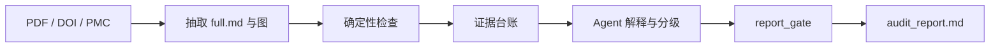

<h1 align="center">chem-integrity-auditor</h1>

<p align="center">
  化学、材料、电化学与分析化学论文的研究诚信审计 skill<br>
  确定性脚本做测量，Agent 做解释；每条发现都带位置、技术和可复核证据。
</p>

<p align="center">
  <a href="LICENSE"></a>
  <a href="requirements.txt"></a>
  <a href="package.json"></a>
  <a href="https://github.com/superdma/chem-integrity-auditor/actions/workflows/smoke.yml"></a>
</p>

<p align="center">
  <a href="#quick-start">快速开始</a> ·
  <a href="#checks">能查什么</a> ·
  <a href="#how-it-works">工作方式</a> ·
  <a href="#scripts">脚本</a> ·
  <a href="#tests">测试</a> ·
  <a href="#principles">原则</a>
</p>

> [!NOTE]
> 报告输出的是审计线索，不是造假判决。结论按 Level 1-4 分级，并写明还需要哪些原始数据才能裁定。

<a id="what"></a>

## 这是什么

给它一篇论文，流水线先抽取正文、表格、图和补充材料，再跑数值、结构、图像与参考谱检查，把命中整理成带定位的证据。Agent 随后逐条做良性解释压力测试，决定异常级别，最后用 `report_gate.py` 检查报告是否漏了定位、证据或分级。

适合：

- 期刊编辑或审稿人做初筛；
- 课题组在投稿前自查；
- 对撤稿通知里的具体指控做复盘。

它不替代期刊、机构或专家的调查，也不会根据单条线索给出造假结论。

<a id="quick-start"></a>

## 快速开始

安装需要 Node.js 18+；运行需要 Python 3.8+、Pillow、NumPy、OpenCV，poppler 负责 PDF 栅格化；Chrome/Chromium 可选，用于生成 A4 PDF 报告。

```bash
# 1. 安装 skill
npx github:superdma/chem-integrity-auditor

# 2. Python 依赖
python3 -m pip install -r ~/.claude/skills/chem-integrity-auditor/requirements.txt

# 3. poppler
sudo apt-get install poppler-utils   # Debian / Ubuntu
# brew install poppler               # macOS

# 4. 自检
python3 ~/.claude/skills/chem-integrity-auditor/scripts/check_env.py
```

`check_env.py` 输出 `Overall: OK` 后，在 Agent 对话里直接说：

```text
用 chem-integrity-auditor 审计 /path/to/paper.pdf
用 chem-integrity-auditor 审计 DOI 10.1039/d5ra01695a
用 chem-integrity-auditor 批量审计 papers/*.pdf，每篇一个 run 目录
```

> [!TIP]
> 不使用 npm 也可以。把仓库克隆或解压到客户端的 skills 目录，确保 `SKILL.md` 位于目录根层。完整步骤见[其它安装方式](#install-options)。

每次运行会生成：

```text
output/chem-integrity-auditor/<slug>/<timestamp>/
├── audit_report.md          # 中文分级报告
├── audit_report.pdf         # A4 交付版（证据图内嵌，需 Chrome/Chromium）
├── input_manifest.md        # 采集与阻断记录
├── findings/{numerical,image,logical}/
├── workdir/                 # 各脚本 JSON 证据
├── panels/                  # 面板 PNG
└── supplementary/           # SI / 撤稿通知
```

<a id="install-options"></a>

<details>
<summary>其它安装方式：链接安装、Claude Code、Cherry Studio、ZIP</summary>

### 把仓库链接交给 Agent

把下面这段原样发给你的 Agent 客户端：

```text
请从 https://github.com/superdma/chem-integrity-auditor 安装 chem-integrity-auditor skill：
1) 将仓库克隆到你使用的客户端的 skills 目录（Claude Code 用 ~/.claude/skills/，
   Cherry Studio 用其 Data/Skills/，其它客户端用其文档指定的 skill 目录）；
2) 安装依赖：python3 -m pip install -r requirements.txt；
3) 安装 poppler（提供 pdftoppm/pdfimages/pdftotext）；
4) 运行 python3 scripts/check_env.py 和 bash tests/smoketest.sh；
5) 把安装路径、check_env 结果和 smoke 结果发给我。
不要修改仓库外的文件，不要把任何 token 写入仓库。
```

Agent 会完成克隆、依赖安装和自检。装好后，把论文 PDF 路径或 DOI 发给它即可。

### Claude Code

```bash
# 个人级（所有项目可用）
git clone https://github.com/superdma/chem-integrity-auditor.git \
  ~/.claude/skills/chem-integrity-auditor

# 或项目级（只在该项目可用）
git clone https://github.com/superdma/chem-integrity-auditor.git \
  .claude/skills/chem-integrity-auditor

python3 -m pip install -r ~/.claude/skills/chem-integrity-auditor/requirements.txt
python3 ~/.claude/skills/chem-integrity-auditor/scripts/check_env.py
```

### Cherry Studio

把仓库放到 Cherry Studio 的 Skills 目录，或在「设置 → Skills / 技能」中导入该目录：

```bash
# Linux
git clone https://github.com/superdma/chem-integrity-auditor.git \
  ~/.config/CherryStudio/Data/Skills/chem-integrity-auditor

# macOS（以客户端设置中显示的 Data/Skills 路径为准）
git clone https://github.com/superdma/chem-integrity-auditor.git \
  "$HOME/Library/Application Support/CherryStudio/Data/Skills/chem-integrity-auditor"

# Windows PowerShell（以客户端设置中显示的 Data/Skills 路径为准）
git clone https://github.com/superdma/chem-integrity-auditor.git `
  "$env:APPDATA\CherryStudio\Data\Skills\chem-integrity-auditor"
```

目录名可以随意，但必须保证 `chem-integrity-auditor/SKILL.md` 在目录根。重启或刷新 Skills 列表后，在对话里说“用 chem-integrity-auditor 审计这篇论文”。

### 手动下载 ZIP

1. 打开 <https://github.com/superdma/chem-integrity-auditor>，选择 **Code → Download ZIP**。
2. 解压到客户端的 skills 目录，确保 `SKILL.md` 位于解压目录根，不要多套一层文件夹。
3. 安装依赖并自检，见下文。

### 依赖与自检

```bash
python3 -m pip install -r requirements.txt

# poppler：pdftoppm / pdfimages / pdftotext
sudo apt-get install poppler-utils     # Debian / Ubuntu
brew install poppler                   # macOS
# Windows 建议在 WSL 中运行，或把 poppler 的 bin 加入 PATH

python3 scripts/check_env.py           # 必须输出 Overall: OK
bash tests/smoketest.sh                # 必须 0 failures
```

- Python 3.8+；Pillow、NumPy、OpenCV、SciPy。
- RDKit 可选，用于结构与分子式交叉校验；openpyxl 可选，用于 XLSX 表格证据图（`pip install openpyxl`）。
- MinerU 可选。只有 PDF/DOI 路线的正文与 SI 解析需要它；PMC 路线用 `pmc_fetch.py`，不需要 MinerU。本地 4.x、2.x-3.x 与官方云 v4 都支持，见 [`references/09-mineru-setup.md`](references/09-mineru-setup.md)。
- Token 只从环境变量读取（`MINERU_API_TOKEN` / `MINERU_API_KEY`），不会写进仓库、报告或 manifest。

### 更新与卸载

```bash
cd <skills>/chem-integrity-auditor && git pull
# 卸载：删除该目录，或在客户端 Skills 设置中移除
```

</details>

<a id="checks"></a>

## 能查什么

| 轨道 | 检查 | 主要脚本 |
|---|---|---|
| 数值 | 收率取整、转化率×选择性、CHN 元素分析与分子式、HRMS 精确质量与加合物、Scherrer 晶粒尺寸、重复值、面积归一、不可实现单位与量程、表格重复行 | `chem_numeric.py`、`numeric_forensics.py`、`nmr_hrms_numeric.py` |
| 结构身份 | name / SMILES / CAS / InChIKey / 分子式 → PubChem；比较分子式、MW、单同位素质量、CHN Calcd/Found、CAS 与新颖性；支持盐、水合物和离线缓存 | `structure_check.py` |
| 图像 | 面板切分（白沟、框架线、内容带）、dHash/aHash、ORB（旋转/镜像/裁剪 + RANSAC inlier/bbox）、谱图曲线与背景噪声指纹、stacked trace 切分与颜色隔离、单条曲线内部片段复用（patch NCC） | `panel_split.py`、`stack_split.py`、`offset_stack_split.py`、`image_dup.py`、`image_dup_orb.py`、`spectral_noise_fingerprint.py`、`spectral_segment_dup.py` |
| 参考谱 | 论文谱图峰位（两点轴校准）或峰表，与 SDBS/NMRShiftDB 导出的峰表比对；不抓取数据库，只做半自动匹配 | `reference_spectrum_match.py` |
| 逻辑 | 合成→纯度→结构→性能的 claim chain、缺失对照、表征与结论不匹配、领域合理性 | Agent 与 [`references/05-logic-track.md`](references/05-logic-track.md) |

<a id="how-it-works"></a>

## 工作方式



[`SKILL.md`](SKILL.md) 把流程拆成 8 步：识别输入、采集全文与图、建立证据台账、跑数值与图像检查、读证据、做良性解释压力测试、分级、跑报告质量门。每一步都写明输入、输出和阻断条件。

<a id="scripts"></a>

## 关键脚本

| 阶段 | 脚本 |
|---|---|
| 解析 | `mineru_convert.py`、`pmc_fetch.py`、`build_evidence_ledger.py` |
| 数值 | `chem_numeric.py`、`numeric_forensics.py`、`nmr_hrms_numeric.py` |
| 结构 | `structure_check.py` |
| 图像 | `panel_split.py`、`stack_split.py`、`offset_stack_split.py`、`image_dup.py`、`image_dup_orb.py`、`spectral_noise_fingerprint.py`、`spectral_segment_dup.py` |
| 参考谱 | `reference_spectrum_match.py` |
| 图库 | `corpus_add.py`、`corpus_match.py` |
| 阈值与门禁 | `calibrate_image_thresholds.py`、`report_gate.py`、`report_figures.py`、`render_report_pdf.py`、`check_env.py` |

<details>
<summary>完整脚本说明</summary>

| 脚本 | 作用 |
|---|---|
| `mineru_convert.py` | PDF → `full.md`；local v1 / local legacy / cloud v4 |
| `pmc_fetch.py` | PMC 全文 XML + 原始 figure 文件 → `full.md` |
| `build_evidence_ledger.py` | 文本、HTML 表、图、caption 的 cell 级 provenance 索引 |
| `chem_numeric.py` | 化学数值异常线索 |
| `numeric_forensics.py` | 通用数值取证：完全重复、重复小数尾、末位数字、Benford 适用性门控 |
| `nmr_hrms_numeric.py` | NMR 积分、13C 峰数、HRMS 同位素与 RDBE 线索 |
| `render_evidence_tables.py` | 可选：从原始 XLSX 单元格生成带高亮的表格证据 PNG |
| `structure_check.py` | PubChem 结构身份核验（离线缓存） |
| `panel_split.py` | 多线索面板切分（白沟、框架线、内容带） |
| `stack_split.py` | 按全宽分隔线切 stacked traces |
| `offset_stack_split.py` | 无分隔线 offset 堆叠谱：候选切线 + 精确 `--cuts`（半自动） |
| `image_dup.py` / `image_dup_orb.py` | 感知哈希 / ORB 变换复用（RANSAC inlier、inlier ratio、bbox、JSON） |
| `spectral_noise_fingerprint.py` | 曲线与背景噪声指纹 |
| `spectral_segment_dup.py` | 单条或两条曲线内部片段复用（patch NCC） |
| `corpus_add.py` / `corpus_match.py` | 本地参考图库登记 / 跨论文 ORB + dHash 匹配 |
| `reference_spectrum_match.py` | 峰表或谱图 vs SDBS/NMRShiftDB 峰表 |
| `calibrate_image_thresholds.py` | 标注对 → ROC/AUC/Youden 阈值标定 |
| `report_gate.py` | 可执行报告质量门（章节、Level 2+ 定位与证据图、禁用结论词） |
| `render_report_pdf.py` | Markdown 审计报告 → A4 PDF；图片内嵌、表格保留、可选页码 |
| `check_env.py` | 环境自检 |

</details>

<a id="tests"></a>

## 测试

```bash
python3 tests/make_fixtures.py
bash tests/smoketest.sh
```

当前基线是 76 项通过、0 失败（无 Chrome/Chromium 时 PDF 用例显示 SKIP，其余 75 项通过）。fresh clone 首次运行会多一项 fixture 生成检查。范围包括所有脚本的编译与 `--help`、数值正负对照、PubChem 离线缓存、参考谱匹配、图像复用、谱图指纹、面板/stack/offset 切分、片段复用、阈值标定、跨论文图库、报告质量门、报告证据图、A4 PDF 渲染，以及 MinerU 三后端 mock 和 auto fallback。

`tests/gold/` 保存了 5 篇真实撤稿论文的逐条指控复盘：

| 结果 | 条数 |
|---|---:|
| 完全复现 | 2 |
| 部分复现 | 3 |
| 未复现 | 3 |
| 无法检验（跨出版物） | 5 |

逐条证据和分级见 [`tests/gold/gold_summary.md`](tests/gold/gold_summary.md)。

<details>
<summary>跨论文复用与报告质量门</summary>

“首次发表于 ref. 1”类指控需要本地参考图库。图必须手工导出，本项目不抓取出版社页面。登记和匹配命令如下：

```bash
python3 scripts/corpus_add.py --corpus corpus --key 10.1016/j.xxxx \
  --doi 10.1016/j.xxxx --title "Reference title" \
  --figure ref-fig1.png --figure ref-fig2.png --license "local audit use only"
python3 scripts/corpus_match.py --query output/.../panels --corpus corpus \
  --json corpus_matches.json --md corpus_matches.md
```

报告写完后跑质量门，退出码非 0 即未通过：

```bash
python3 scripts/report_gate.py output/.../audit_report.md \
  --run-dir output/.../workdir --json report_gate.json --strict

python3 scripts/render_report_pdf.py output/.../audit_report.md \
  --output output/.../audit_report.pdf
```

`render_report_pdf.py` 需要本机有 Chrome/Chromium；没有时仍交付 Markdown 报告，并在交付说明中注明 PDF 未生成。

</details>

<a id="principles"></a>

## 设计原则

- 发现是证据，不是判决。报告写 Level 1-4 异常和“需原始数据裁定”，不写“造假/fraud”。
- 每条发现都要有可解析的定位：markdown 行或页、表 id + 行列 + 原值、图 id + panel、图像路径、所用技术。
- 确定性脚本先跑。Agent 负责解释、做良性解释压力测试和分级。
- dHash、ORB、数据库命中本身不构成造假。需要结合论文自身 claim 和第二条独立证据。
- 不抓取 SDBS 或出版社页面。参考峰表与 ref. 1 图由人工导出。
- 不修改被审计论文，也不改其它 skill 的输出。
- Token 和 API secret 只从环境变量读取。

<a id="status"></a>

## 当前状态

已经完成的功能：

- 多线索面板切分、PMC HTML 表进台账、单条曲线片段复用、阈值标定 harness、环境自检与 CI；
- NMR、13C、HRMS 同位素检查；
- 真实 MinerU cloud v4 验证；
- 5 篇真实撤稿论文 gold set，13 条撤稿指控逐条给出 reproduced / partial / not reproduced / untestable 与分级；
- 本地跨论文参考图库（`corpus_add.py` + `corpus_match.py`）；
- 无分隔线 offset 堆叠谱半自动切分；
- 可执行报告质量门。

接下来：

- 补充图库种子数据，需要人工导出 ref. 1 图；
- 在更多标注对上复核图像阈值。

<details>
<summary>仓库结构</summary>

```text
SKILL.md                 # skill 合同与 8 步流水线
agents/openai.yaml       # 通用 Agent 客户端的显示名/默认提示词
references/00-11         # 增量执行、采集、技术目录、数值/图像/逻辑/分级、结构、参考谱、MinerU、图库/质量门、方法论
scripts/                 # 确定性脚本（无 LLM SDK）
templates/               # 中文 audit_report 模板
bin/install.js           # npm/npx 一条命令安装器（不装依赖、不写 token）
package.json             # npm 包清单（files 白名单）
tests/                   # 生成式 fixtures + smoke + MinerU mock + gold set
.github/workflows/       # CI smoke
ACKNOWLEDGEMENTS.md      # 第三方依赖、数据源、算法引用与许可证
```

</details>

<a id="acknowledgements"></a>

## 第三方依赖与致谢

完整清单、许可证和引用见 [`ACKNOWLEDGEMENTS.md`](ACKNOWLEDGEMENTS.md)。主要依赖：

| 项目 | 用途 | 许可证 |
|---|---|---|
| [Pillow](https://python-pillow.org/) | 图像读写与绘制 | HPND |
| [NumPy](https://numpy.org/) | 数值计算 | BSD-3-Clause |
| [OpenCV](https://opencv.org/) | ORB、模板匹配、RANSAC | Apache-2.0 |
| [SciPy](https://scipy.org/) | 可选统计与信号辅助 | BSD-3-Clause |
| [RDKit](https://www.rdkit.org/) | 可选结构/分子式校验 | BSD-3-Clause |
| [openpyxl](https://openpyxl.readthedocs.io/) | 可选 XLSX 表格证据图 | MIT |
| [Poppler](https://poppler.freedesktop.org/) | `pdftoppm` / `pdfimages` / `pdftotext` | GPL-2.0（独立可执行程序） |
| [MinerU](https://github.com/opendatalab/MinerU) | 可选 PDF → Markdown | AGPL-3.0（以仓库为准） |
| [PubChem PUG REST](https://pubchem.ncbi.nlm.nih.gov/) | 化合物身份核验 | NCBI 数据使用条款 |
| [SDBS](https://sdbs.db.aist.go.jp/) / [NMRShiftDB](https://nmrshiftdb.nmr.uni-koeln.de/) | 参考谱峰表 | 各自数据库条款；仅人工导出，不抓取 |
| [Europe PMC](https://europepmc.org/) / PMC | 全文与 figure 获取 | NLM 条款 |

算法与思想参考：dHash/aHash 感知哈希（`imagehash` 社区的公开方法）、ORB（Rublee et al., 2011）、Lowe ratio test（Lowe, 2004）、RANSAC（Fischler & Bolles, 1981）、Benjamini-Hochberg FDR（1995）、Fisher z、Scherrer 方程。

<a id="contributing"></a>

## 反馈与参与

发现误报、漏报或新的撤稿案例，可以在 [Issues](https://github.com/superdma/chem-integrity-auditor/issues) 里附上论文 DOI 和复现命令。提交代码前请先跑 `bash tests/smoketest.sh`。

<a id="license"></a>

## License

本项目采用 MIT License，见 [`LICENSE`](LICENSE)。第三方依赖、数据库和可选服务仍受各自许可证或条款约束；使用 MinerU、Poppler、SDBS、NMRShiftDB、PubChem 前请阅读其上游条款。
